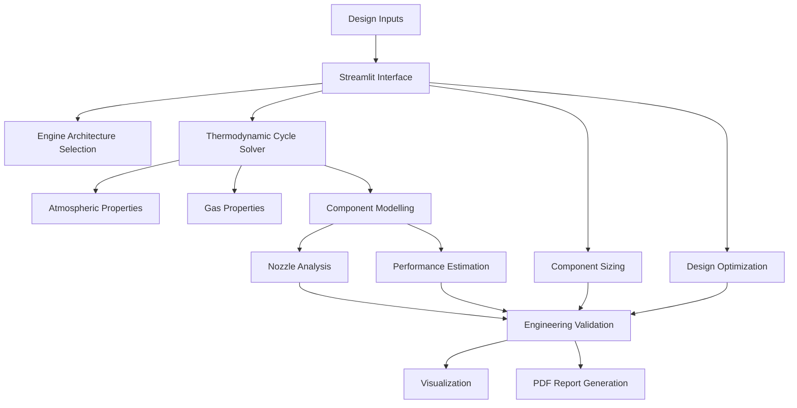

# AEROTHERM-X 🚀
### Aerospace Propulsion Design & Analysis Environment

**A modular computational platform for preliminary gas-turbine engine design, thermodynamic cycle analysis, performance estimation, component sizing and multi-objective optimization.**

## Overview

**AEROTHERM-X** is a Python-based aerospace propulsion analysis environment developed to integrate multiple preliminary gas-turbine engine design and performance calculations into a unified engineering application.

The platform focuses primarily on separate-flow, two-spool turbofan engines, combining thermodynamic cycle analysis, component performance estimation, nozzle calculations, preliminary geometric sizing and computational optimization.

Rather than functioning as a conventional engineering calculator, AEROTHERM-X aims to provide an integrated environment for exploring propulsion system configurations, evaluating design parameters and understanding the relationships between engine architecture, thermodynamic performance and geometric constraints.

The application is designed with a modular architecture, allowing individual engineering models to be improved, tested and expanded independently.

**Development status:** Active development | Preliminary engineering analysis

---

## ✈️ Core Engineering Capabilities

### 1. Engine Architecture Selection
- Preliminary propulsion architecture recommendation.
- Bypass ratio-based classification.
- Mach-number-based screening.
- Comparative architecture exploration.

### 2. Thermodynamic Cycle Analysis
- Separate-flow, two-spool turbofan modelling.
- Station-based thermodynamic calculations.
- Temperature-dependent gas-property approximations.
- Compressor and turbine pressure ratios.
- Combustion chamber modelling.
- Fuel-air ratio estimation.
- Spool power balance.
- Thermal and propulsive efficiency estimation.

### 3. Nozzle Performance Analysis
- Convergent nozzle calculations.
- Convergent-divergent nozzle calculations.
- Critical pressure ratio estimation.
- Choked-flow identification.
- Exit velocity and temperature estimation.
- Pressure thrust calculations.
- Throat and exit area estimation.

### 4. Preliminary Component Sizing
- Fan diameter estimation.
- Core airflow estimation.
- Compressor and turbine preliminary sizing.
- Nozzle area calculations.
- Geometric scaling utilities.

### 5. Performance Analysis
- Thrust estimation.
- Specific fuel consumption.
- Thermal efficiency.
- Propulsive efficiency.
- Overall efficiency.
- Parameter sensitivity studies.
- Performance variation across operating conditions.

### 6. Computational Optimization
- Differential Evolution optimization.
- Fan pressure ratio exploration.
- Bypass ratio optimization.
- Core compressor pressure ratio optimization.
- Turbine inlet temperature constraints.
- TSFC minimization.
- Efficiency maximization.
- Frontal-area proxy minimization.
- Pareto-style design-space exploration.

### 7. Flight Envelope and Mission Estimation
- Preliminary flight-condition analysis.
- Corrected-state-based performance estimation.
- Thrust lapse estimation.
- Mission-level range calculations.
- Breguet range relation.

### 8. Visualization and Reporting
- Interactive thermodynamic plots.
- Engine station visualization.
- Conceptual 3D engine representation.
- Performance comparison charts.
- Optimization history visualization.
- Automated PDF engineering reports.

---

## 🧩 Software Architecture

AEROTHERM-X follows a modular Python architecture.

```text
AEROTHERM-X/
│
├── app.py
├── config.py
├── requirements.txt
├── README.md
│
├── core/
│   ├── atmosphere.py
│   ├── component_sizing.py
│   ├── cycle_solver.py
│   ├── engine_selector.py
│   ├── gas_properties.py
│   ├── mission.py
│   ├── nozzle.py
│   ├── optimization.py
│   ├── performance.py
│   ├── scaling.py
│   └── validation.py
│
├── visualization/
│   ├── cycle_diagrams.py
│   └── engine_3d.py
│
├── reports/
│   └── pdf_generator.py
│
├── benchmarks/
│   └── cfm56_7b.py
│
├── tests/
│   └── test_core.py
│
├── ui/
│   └── theme.css
│
├── docs/
│   ├── ENGINEERING_SCOPE.md
│   └── DEVELOPMENT.md
│
└── .streamlit/
    └── config.toml
```

### Computational Workflow



---

## 🛠️ Technology Stack

| Technology | Application |
|---|---|
| Python | Core computational framework |
| Streamlit | Interactive engineering interface |
| NumPy | Numerical computation |
| SciPy | Numerical methods and optimization |
| Pandas | Data handling |
| Plotly | Interactive engineering visualization |
| ReportLab | PDF report generation |
| Three.js | Conceptual 3D engine visualization |

---

## Installation and Execution

### Prerequisites

- Python 3.10 or newer
- Git
- pip
- Modern web browser

### 1. Clone the Repository

```bash
git clone https://github.com/YOUR-USERNAME/AEROTHERM-X.git
```

### 2. Navigate to the Project

```bash
cd AEROTHERM-X
```

### 3. Create a Virtual Environment

**Windows:**

```bash
python -m venv .venv
.venv\Scripts\activate
```

**Linux / macOS:**

```bash
python3 -m venv .venv
source .venv/bin/activate
```

### 4. Install Dependencies

```bash
python -m pip install --upgrade pip
pip install -r requirements.txt
```

### 5. Launch AEROTHERM-X

```bash
streamlit run app.py
```

The application will normally become accessible at:

```text
http://localhost:8501
```

---

## 🧪 Testing and Benchmarking

The project includes a core calculation test script and a preliminary CFM56-7B-inspired reference case.

Run the core tests:

```bash
python tests/test_core.py
```

Run the reference-case script:

```bash
python benchmarks/cfm56_7b.py
```

These are development and comparison tools. They do not establish independent experimental validation or manufacturer-level accuracy.

---

## Engineering Assumptions and Limitations

AEROTHERM-X is currently a preliminary engineering analysis platform.

The following limitations should be considered when interpreting results:

- Combustion products are not fully modelled using composition-resolved chemical equilibrium.
- Turbine cooling and detailed bleed-flow allocation are not implemented.
- Compressor and turbine component maps are not available.
- Full off-design spool matching is not implemented.
- Corrected-state-based flight-envelope calculations are approximate.
- Detailed three-dimensional CFD is not integrated.
- No detailed blade-row aerodynamic or structural analysis is performed.
- Nozzle calculations use simplified one-dimensional assumptions.
- The 3D engine visualization is conceptual rather than manufacturing-ready geometry.
- Engine architecture recommendations are heuristic.

The numerical outputs should therefore be interpreted within the assumptions and operating ranges of the implemented models.

---

## 🔬 Future Development Roadmap

The long-term objective is to progressively improve the physical fidelity and engineering reliability of the platform.

| Development Area | Planned Improvement |
|---|---|
| Thermodynamics | Improved combustion-product property modelling |
| Compressors | Component performance maps |
| Turbines | Turbine maps and cooling-flow modelling |
| Off-design analysis | Component-map-based spool matching |
| Nozzles | Improved compressible-flow and shock modelling |
| Optimization | Robust constrained multi-objective optimization |
| Validation | Traceable published-engine benchmark database |
| Geometry | More detailed parametric engine geometry |
| Mission analysis | Expanded mission-profile simulation |
| Reporting | Automated technical design documentation |

---

## Project Philosophy

AEROTHERM-X is being developed around three engineering principles:

**1. Physical Consistency**

Engineering calculations should be based on identifiable physical relationships, governing equations and clearly stated assumptions.

**2. Computational Transparency**

Users should be able to understand the inputs, assumptions, computational methods and limitations behind calculated outputs.

**3. Progressive Model Fidelity**

The objective is to improve the accuracy and depth of individual engineering models rather than simply increase the number of software features.

---

## Author

**Mohammed Sadaath**

Aerospace Engineering Undergraduate  
Developer of AEROTHERM-X

Interested in aerospace propulsion, computational engineering, numerical modelling and advanced aerospace systems.

---

## Disclaimer

AEROTHERM-X is an independent educational and preliminary engineering software project.

It is not a certified aerospace design platform. Its outputs have not been established as suitable for aircraft certification, propulsion hardware manufacturing, flight operations or safety-critical engineering decisions.

All calculations, assumptions and results must be independently verified before engineering application.

---

**AEROTHERM-X — Exploring the Engineering Behind Propulsion.**
